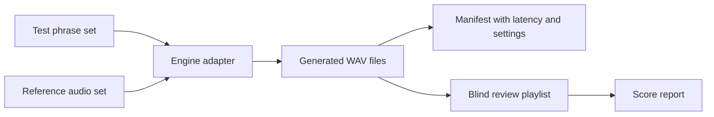

# Voice Clone Strategy Design

Date: 2026-07-03
Status: approved for planning

## Goal

Build a repeatable, local-first process for making Saymo speak in the user's voice with the best practical balance of similarity, Russian pronunciation, latency, disk cost, and integration risk.

## Current Baseline

The current local configuration uses:

- `tts.engine: f5tts_clone`
- `~/F5TTS/models/ru/F5TTS_v1_Base_v2/model_last.pt`
- `~/F5TTS/models/ru/F5TTS_v1_Base/vocab.txt`
- `~/.saymo/voice_samples/voice_sample.wav`
- `speech.composer: ollama`
- `ollama.model: qwen2.5-coder:7b`
- STT default: `faster-whisper large-v3`

The previous XTTS/RVC/Applio artifacts were removed to save disk. Training datasets and voice samples were preserved.

## Decision

Do not reinstall every voice-cloning stack. Use a controlled voice-clone shootout:

1. Keep **F5-TTS Russian** as the baseline.
2. Add at most two challengers at a time.
3. Run the same reference audio and the same Russian phrase set through every candidate.
4. Promote a candidate only if it beats F5 in blind A/B on voice similarity without unacceptable artifacts or latency.

## Candidate Model Policy

### Tier 0: Current Production Baseline

**F5-TTS Russian** stays active.

Why:

- Already integrated in Saymo.
- Strong Russian focus.
- One-stage cloning, fewer moving parts than XTTS plus RVC.
- Works on CPU in the current setup.
- The repo already has `saymo/tts/f5tts.py` and `docs/F5TTS-VOICE-CLONING.md`.

Reference sources:

- https://github.com/SWivid/F5-TTS
- https://huggingface.co/Misha24-10/F5-TTS_RUSSIAN

### Tier 1: First Challengers

**Qwen3-TTS Base** is the first serious challenger, but use the Base model for voice cloning tests, not only the CustomVoice model.

Why:

- Current Saymo docs already have Qwen3 scaffolding.
- Qwen3 has a path toward real-time/streaming use.
- It is the most relevant candidate if the goal is live-call answers, not just prepared playback.

Risk:

- Higher integration complexity.
- The existing Qwen3 trainer scaffold is not ready for LoRA training because loss implementation still needs real model API work.
- Do not start with fine-tuning. Start with zero-shot benchmark.

Reference sources:

- https://github.com/QwenLM/Qwen3-TTS
- `docs/PRD-qwen3-tts.md`

**CosyVoice 3** is the second practical challenger if Qwen3 setup is too heavy or low-quality on Mac.

Why:

- Supports zero-shot and cross-lingual voice cloning.
- Supports streaming-oriented use cases.
- Apache-2.0 license in upstream repo is attractive for future reuse.

Risk:

- Integration is likely heavier than F5.
- Needs its own isolated environment.

Reference source:

- https://github.com/FunAudioLLM/CosyVoice

### Tier 2: Research / Fallback Candidates

**Chatterbox multilingual** can be tested if Qwen3 and CosyVoice are not acceptable.

Why:

- Modern multilingual zero-shot candidate.
- Smaller model class than very large TTS stacks.

Risk:

- Need to verify Russian quality locally.
- Not currently wired into Saymo.

Reference source:

- https://github.com/resemble-ai/chatterbox

**GPT-SoVITS** is held for a second phase only.

Why:

- Strong few-shot/fine-tune workflow.
- Useful if zero-shot systems cannot match the voice.

Risk:

- More training and artifact management.
- Higher operational cost after the previous XTTS/RVC cleanup.

Reference source:

- https://github.com/RVC-Boss/GPT-SoVITS

**Fish Speech** and **OpenVoice** are not first-pass choices.

Why:

- Fish Speech is powerful but heavier and more research-oriented.
- OpenVoice is easy to experiment with, but Russian quality is less clearly aligned with this project than F5/Qwen/CosyVoice.

Reference sources:

- https://github.com/fishaudio/fish-speech
- https://github.com/myshell-ai/OpenVoice

## Evaluation Dataset

Use the same inputs for every candidate:

- Reference A: `~/.saymo/voice_samples/voice_sample.wav`
- Reference B: a fresh 15-second clean Russian call-style sample
- Reference C: a fresh 45-60 second Russian sample with statement, question, list, and mild emphasis

Do not mix microphone types, speaking registers, or room conditions in the same benchmark.

## Test Phrase Set

Use short call-style Russian phrases:

1. "Доброе утро, коллеги. Вчера я закрыл проверку релиза."
2. "Сегодня планирую пройтись по логам и добить автотесты."
3. "Блокеров сейчас нет, но есть риск по стабильности окружения."
4. "Если деплой пройдет без ошибок, я обновлю статус задачи."
5. "Да, я проверял этот сценарий на стейдже."
6. "Можно уточнить, какой именно кейс сейчас воспроизводится?"
7. "По моим данным, проблема не в конфиге, а в данных."
8. "Я вернусь с результатом после повторного прогона."
9. "Сейчас лучше не трогать прод, пока не закроем проверку."
10. "Коротко: тесты зеленые, но нужен еще один контрольный запуск."

## Scoring Rubric

Score each generated clip from 1 to 5:

- Voice similarity: sounds like the user, not just a fluent Russian speaker.
- Naturalness: prosody, pacing, breath, phrase endings.
- Russian pronunciation: stress, technical terms, mixed English abbreviations.
- Artifacts: metallic sound, buzz, crackle, instability, missing words.
- Latency: time to final WAV for one short phrase.
- Integration cost: environment isolation, dependencies, repeatability.

Promotion gate:

- A candidate must win at least 7 of 10 blind A/B comparisons against F5 on similarity.
- It must not introduce worse artifacts than F5.
- For live-call use, it must produce 1-2 sentence answers within 8 seconds end to end or support a cached fallback.

## Architecture

The benchmark should be engine-agnostic:

Each candidate gets an isolated adapter script or command wrapper. The Saymo runtime stays on F5 until a candidate passes the gate.

## Operational Rules

- Do not delete `~/.saymo/training_dataset*`.
- Do not delete `~/.saymo/voice_samples`.
- Do not install or download a candidate until the previous candidate has a report.
- Keep model environments outside Saymo's main `.venv` unless the package is already compatible.
- Keep all generated benchmark audio under `~/.saymo/voice_benchmarks/<run_id>/`.
- Keep configs and manifests in JSON so reports are reproducible.

## Recommended Execution Order

1. Build the benchmark harness around the current F5 engine.
2. Re-record the two fresh reference samples.
3. Run F5 baseline and score it.
4. Add Qwen3-TTS Base as the first challenger.
5. If Qwen3 is blocked or loses, add CosyVoice 3 as the second challenger.
6. Stop and choose a winner before trying GPT-SoVITS.
7. Only if all zero-shot candidates fail, plan a fine-tune track.

## Non-Goals

- No automatic publishing of cloned voice samples.
- No cloud voice cloning services.
- No impersonation of other people.
- No production config flip before blind A/B passes.
- No broad reinstall of XTTS/RVC/Applio unless the fine-tune track is explicitly approved.
